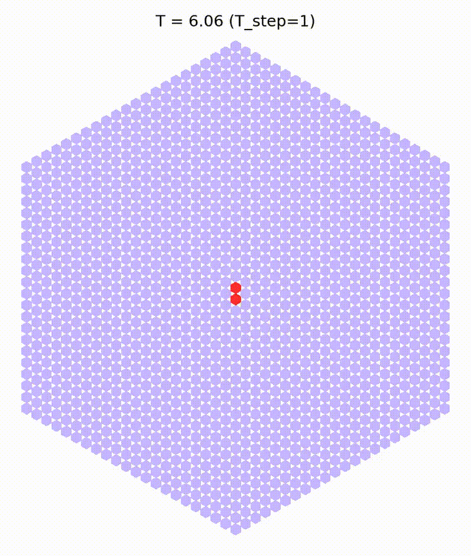

# vsim (Temporary) — Stochastic Spatial Infection Simulator

This repository contains a stochastic, spatially explicit infection
simulation model implemented using Tellurium (Gillespie SSA).
The simulator reproduces the reaction-diffusion infection model
used in "*Interferon-driven altruistic cell death contributes to viral containment*".

The code is organized as a reusable Python package
to ensure reproducibility and parameter traceability.



## Model Overview

The model represents cells arranged on a hexagonal lattice.
Each cell can exist in one of the following discrete states:

- UI: Uninfected
- I: Infected
- DA, DB, DE: Death-associated states
- X: Death factor
- dX: Diffusive death signal

Infection propagates via local neighbor interactions.
The model is simulated using Gillespie SSA implemented in Tellurium.


### Implementation Notes

- The hexagonal neighbor structure is defined in `model/lattice.py`.
- The reaction network is generated as an Antimony string in `model/reaction.py`.
- `simulation/readout.py` converts species values into a discrete state code `S`:
  0=UI, 1=I, 2=DA, 3=DB, 4=DE.
  
### Computational Notes

- Large lattice sizes (e.g., `cell_iter=10000`) significantly increase runtime.
- Parallelization (`n_jobs`) applies to cell-level readout processing.
- The Gillespie integrator is configured with `variable_step_size=False`
  to ensure fixed sampling resolution.

## Repository Structure
```
src/
└── vsim/
    ├── model/
    │   ├── lattice.py        # Hexagonal lattice generation
    │   ├── params.py         # Model parameter dataclass
    │   └── reaction.py       # Reaction network generation (Antimony)
    ├── simulation/
    │   ├── runner.py         # Main simulation entry point
    │   └── readout.py        # Cell state extraction
    └── util/
        ├── cli.py            # Command-line interface
        ├── formatting.py
        └── params_io.py

examples/                       # Example runs
paper/                         # Scripts reproducing figures
pyproject.toml
```

## Installation

We recommend using a dedicated conda environment.

### 1) Create and activate an environment

```bash
conda create -n vsim python=3.10 -y
conda activate vsim
```

### 2) Install the package from `pyproject.toml`

From the repository root (where `pyproject.toml` is located):

```
pip install -U pip
pip install -e .
```
### 3) (Optional) If Tellurium installation via pip fails
```
conda install -c conda-forge tellurium -y
pip install -e .
```

## Quick Start
The repository includes minimal runnable examples under the `examples/` directory.

Each example can be executed with:

```
python run.py
```
from inside the corresponding examples folder.

### 1️⃣ Minimal WT Run (No Pretreatment)
Directory:

```
examples/wt_1run/
```
Run:

```
cd examples/wt_1run
python run.py
```
This will:

- Use default WT parameters
- Run a single stochastic simulation
- Generate a CSV file in `./output/`
- Use a reduced lattice (`cell_iter=1000`) for quick testing

### 2️⃣ Pretreatment Example
Directory:

```
examples/pt_1run/
```
Run:

```
cd examples/pt_1run
python run.py
```
This example:

- Enables pretreatment (`pretreat=True`)
- Runs pre-infection phase for `t_start=50`
- Initializes uniform `dX0=10`
- Uses larger lattice (`cell_iter=10000`)
- Runs post-infection simulation for 500 time units

### 3️⃣ Parameter Perturbation Example (e.g., IFNRKO)
Directory:

```
examples/pert_1run/
```

Run:

```
cd examples/pert_1run
python run.py
```

This example:

- Loads parameter overrides from `ifnrko.json`
- Applies changes using `override_params`
- Saves the exact parameters used to `params_used.json`
- Runs a single stochastic simulation

### Output Format
Each run generates:

- `runX_*.csv` → simulation results (long-form dataframe)
- `runX_params_used.json` → exact parameters used

The CSV contains:

| Column | Meaning                         |
| ------ | ------------------------------- |
| IDX    | Cell index                      |
| X,Y,Z  | Lattice coordinates             |
| T      | Time (aligned so infection = 0) |
| S      | Cell state code                 |
| Df     | Diffusive factor (dX)           |
| Deathf | Death-associated factor (X)     |

## Reproducibility

- Stochastic simulations are reproducible given the same random seed.
  In `run_many_and_save`, each run uses `seed = run` (0, 1, 2, ...).
- For traceability, the parameter set used in each run is saved as JSON.
- Time is aligned so that the infection event occurs at `T = 0`
  (the reported time is shifted by the pre-treatment duration when enabled).

To fully snapshot the environment:

```
conda env export --no-builds > environment.yml
```
or 

```
pip freeze > requirements-lock.txt
```

## Parameter System

Model parameters are defined in `model/params.py` using a dataclass (`ModelParams`).

Parameters can be overridden programmatically or via JSON files:

```
from vsim.model import ModelParams
from vsim.util.params_io import override_params
```

A subset of kinetic parameters is automatically scaled by `param_scale` when generating the reaction network (see `SCALED_KEYS` in `params.py`).

## Citation

If you use this simulator, please cite:

*Interferon-driven altruistic cell death contributes to viral containment.*

## Contact

For questions regarding the simulation code and implementation:

- **Phuc Nguyen** – Original model development  
  nguyenhuubaphuc@gmail.com

- **Takahiro G. Yamada** – Refactoring and reproducibility framework  
  tayamada@ucsd.edu

For questions related to the biological interpretation or the manuscript:

- **Nan Hao** – Corresponding Author  
  nhao@ucsd.edu